# Full Stick

▶ **CM 動画があります**: https://www.youtube.com/watch?v=7773MsnY1Ag （上の画像をクリックしても再生できます）

チーム「チャオベン最強伝説」（os_2619）: 橋本康佑（チャオベン）・富本康太・河島航・相良拓海

🏆 JPHACKS 2026 Hack Day の大阪会場で、オーディエンス投票により **Hack Day Audience Award** をいただきました。

## 各種リンク

- デモ動画URL（CM 動画）: https://www.youtube.com/watch?v=7773MsnY1Ag
- AwardDayスライドURL:

## 製品概要

> 拾ったカッコイイ棒で、魔法の杖を振る。

### 背景(製品開発のきっかけ、課題等）

みなさん、世界で一番ワクワクする瞬間は「カッコイイ棒を拾ったとき」ですよね。

子供のころ、木の棒を拾って魔法使いごっこをした人は多いと思います。このプロダクトの原点も、兵庫県朝来市生野町にある友達の家の近くの沢で、カッコイイ棒を拾ったことでした。

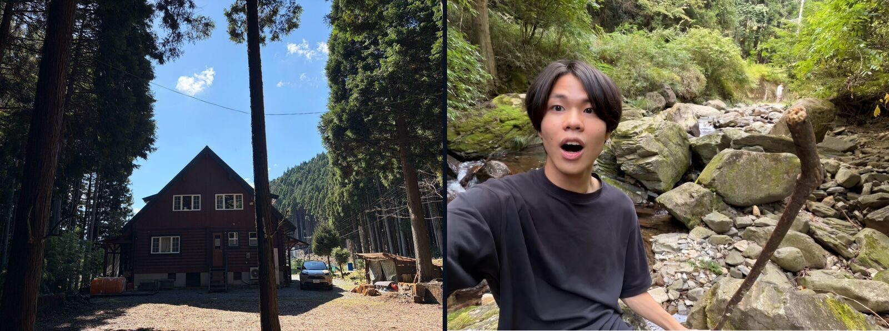

子供のころの私たちは、棒が 1 本あれば、それを魔法の杖にも伝説の剣にもできました。棒 1 つで、自分の世界をどこまでも広げられる自由な力を持っていたはずです。

ところが大人になると、その少年心を忘れてしまいます。効率よく、役に立つように毎日を過ごすうちに、道ばたの棒を拾って空想の世界で遊ぶことはなくなりました。棒は、ただの棒になったのです。取り戻したいと思っても、そのきっかけがありません。

**Full Stick は、大人になると忘れてしまう少年心を取り戻すためのプロダクトです。** 拾った棒を、本当に魔法が撃てる杖に変える新しいインターフェースです。

AI 時代の今、ソフトウェアやハードウェアの階層のずっと下には、とても魅力的な存在があります。木です。便利な技術に囲まれて、私たちはその存在をすっかり忘れていないでしょうか。

JPHACKS 2026 のテーマは「X-Tech 2026 〜Full Stack Hackers〜」です。一般に「フルスタック」と言えばハードウェアまでを指しますが、私たちはその下にある木まで扱ってこそ本当のフルスタックだと考えました。プロダクト名の **Full Stick** は、Full Stack と「振るスティック」を掛けています。

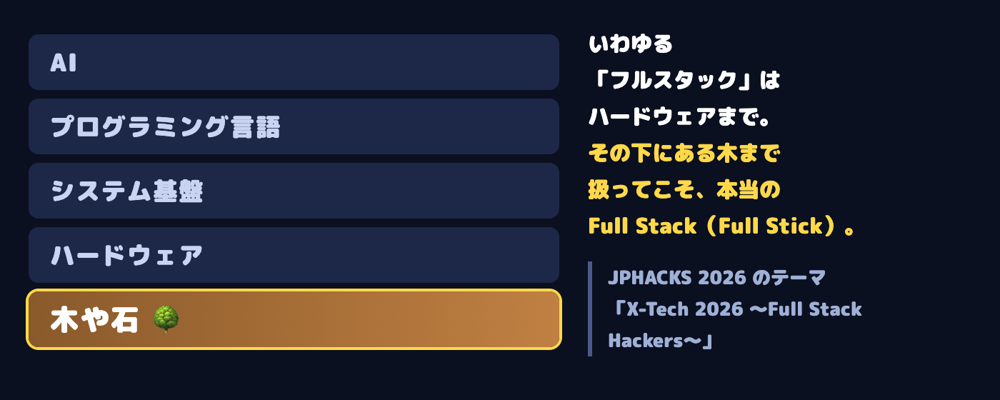

公園に落ちている、自分だけのカッコイイ木の棒で、魔法を使って戦えたらいいな。
子供のころに誰もが思い描いたその夢を、技術の力で本当にかなえようと考えました。

ところが、ごっこ遊びを「ゲーム」にしようとすると、壁がありました。

- 魔法が当たったかどうかは、**お互いの位置が正確にわからないと決められない**
- 棒を「振った」「回した」「止めた」を、**棒の動きから見分けなければならない**
- 遅れが大きいと、**避けたつもりが当たっていた**ことになり、対戦として成り立たない

これらをまとめて解決することで、ごっこ遊びではなく、本当に勝ち負けのある魔法バトルを作りました。

### 製品説明（具体的な製品の説明）

落ちている木の棒を拾って、自分だけの魔法の杖を作り、バーチャル空間上で魔法を出して相手と戦えるゲームです。

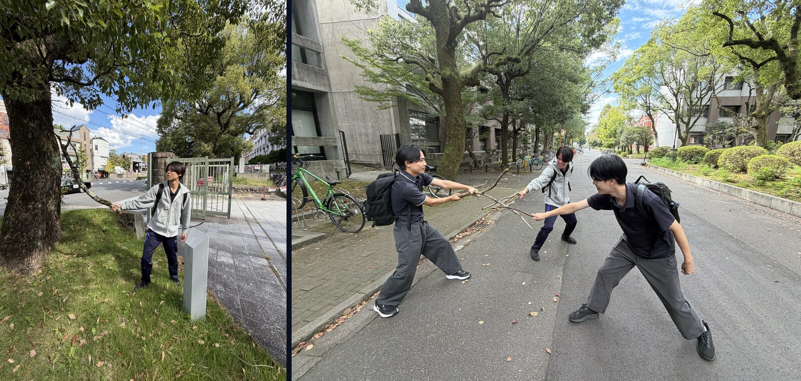

拾った棒にはセンサーをテープで留めるだけです。専用のコントローラーはいりません。

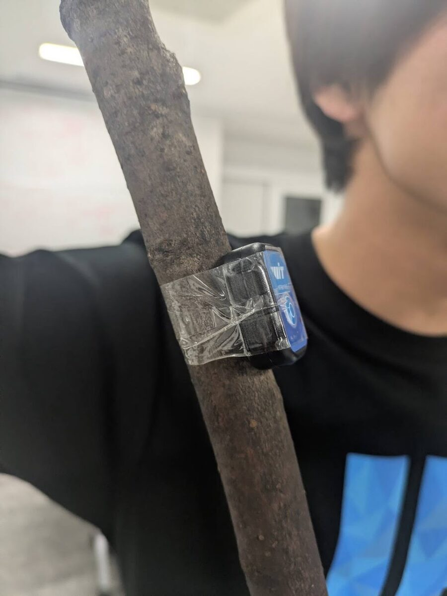

棒に取り付けたセンサーで動きを読み取り、床に敷いた 4 枚の魔法陣と胸のスマホで、二人の位置を 1 つの 3D 空間に重ねます。棒を回して魔法を溜め、振ってピタッと止めると、その向きに魔法が飛びます。第三者視点のカメラ映像に炎や雷のエフェクトを重ねてプロジェクターに映すので、見ている人も一緒に楽しめます。

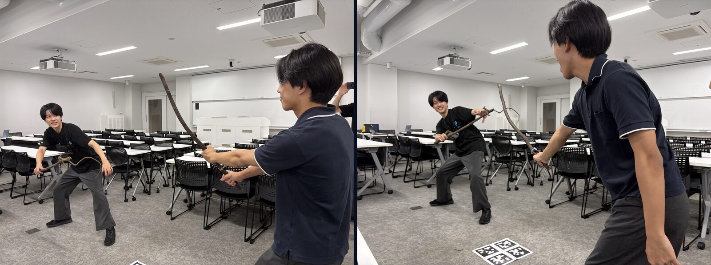

試合は、実況の「スリー、ツー、ワン、フルスティック！」の合図とともに 3 秒のカウントダウンで始まり、60 秒間戦います。HP は 100 で、先に相手の HP を 0 にしたほうが勝ちです。

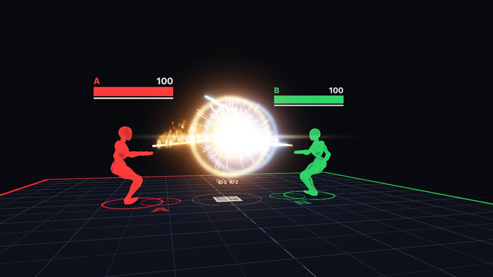

試合中は、溜め・発射・撃ち合い・ガードの場面が次々に入れ替わります。

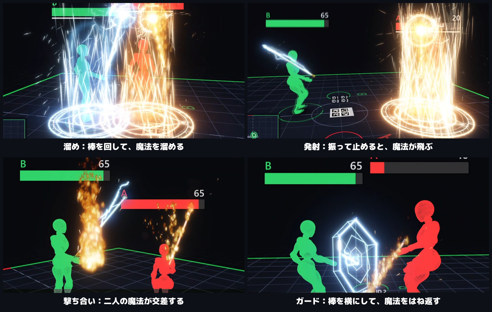

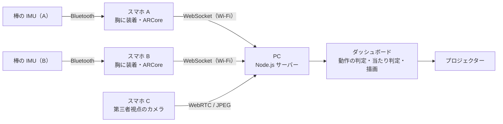

| 役割 | 内容 |
|---|---|
| スマホ A・B | 胸に付けて、棒の IMU を Bluetooth で受け取り、自分の位置と向きを ARCore で追跡して PC へ送る |
| スマホ C | 少し離れた場所から二人を撮る第三者視点のカメラ |
| PC | 動作の判定、当たり判定、エフェクトの描画、プロジェクターへの出力 |

### 特長

#### 1. 相手との位置関係が正確にわかる

床に敷いた 4 枚の魔法陣が、フィールドの原点です。スマホがこの魔法陣を読み取り、二人の位置を 1 つの座標系にそろえます。魔法陣は見た目の演出であると同時に、位置合わせのマーカーでもあります。

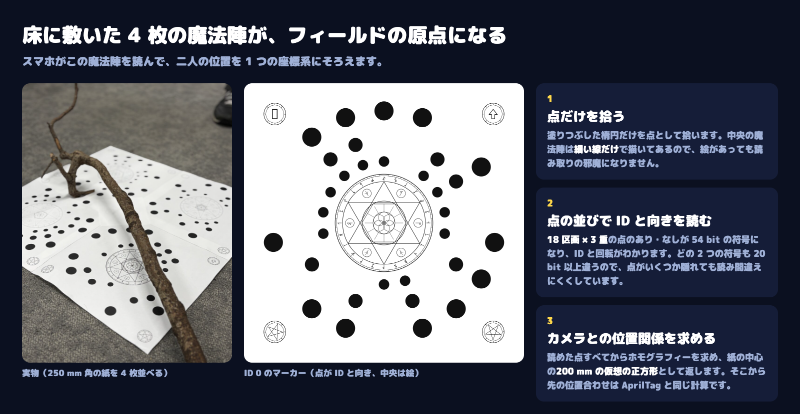

魔法陣のマーカー、ARCore、IMU を組み合わせて、二人の位置と棒の向きを 1 つの 3D 空間に置きます。相手との間隔が明確にわかるので、相手を狙って攻撃することも、飛んでくる魔法を体を動かして避けることもできます。

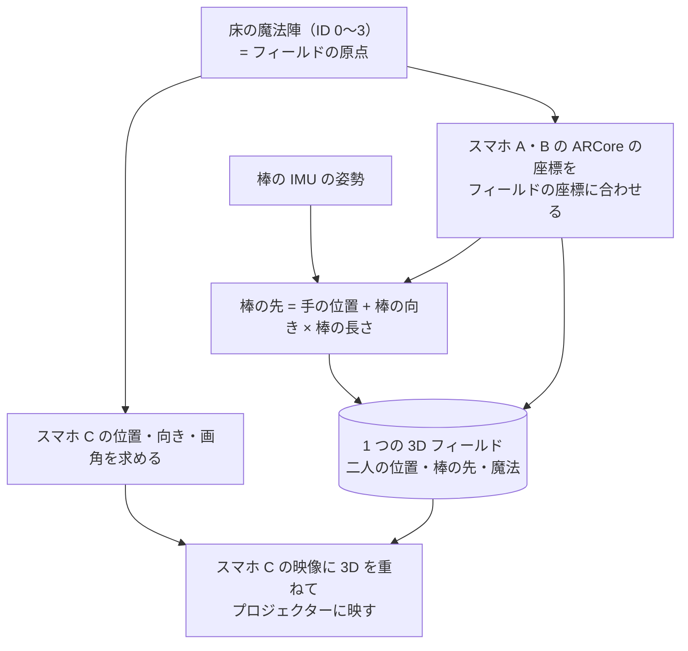

#### 2. 「溜めるほど強いが、溜めている間は無防備」というゲーム性

棒を回して魔法を溜め、振ってピタッと止めて撃ちます。溜めた時間で技が変わります。

| 溜めた時間 | 技 | ダメージ（初期値） |
|---|---|---|
| 溜めなし、または 2 秒未満 | 小（連打できる） | 5 |
| 2〜5 秒 | 中 | 20 |
| 5 秒以上 | 大（必殺技） | 60 |

溜めている間は足を止めなければならず（50cm 動くと失敗）、避けられません。溜めている様子は棒の先の玉がだんだん大きくなって見えるので、「溜めを潰しにいくか、自分も溜めるか」という駆け引きが生まれます。

さらに、棒を水平に構えて止めると防御になり、小の魔法は相手に跳ね返せます。跳ね返した小は 2 倍のダメージになります（中・大は貫通します）。

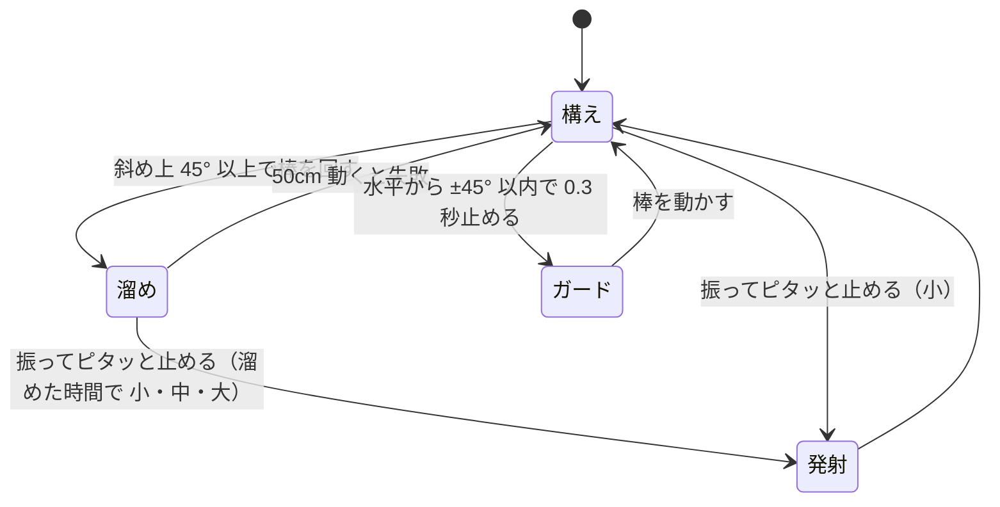

#### 3. 棒に応じた魔法のタイプと、独自のエフェクト

魔法には炎と雷のタイプがあり、それぞれに小・中・大、溜め、ガードのエフェクトとサウンドを作りました。プロジェクターには、カメラの映像に魔法が重なって映ります。

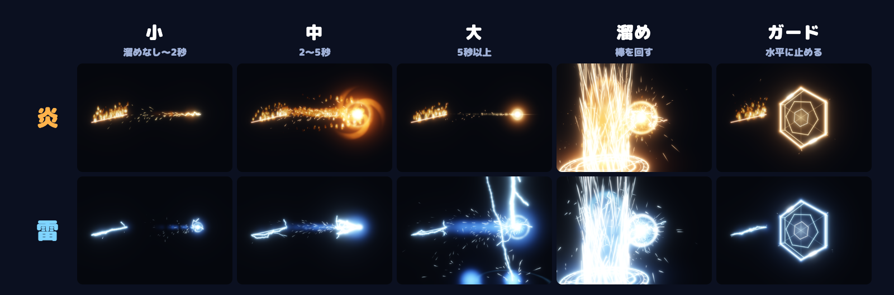

エフェクトの素材（炎や稲妻のテクスチャ）は Gemini API で生成し、three.js のシェーダーで動かしています。Hack Day の時点ではプレイヤー A が炎、B が雷に固定です。拾った棒の形状や色に応じてタイプを割り当てる仕組みは、これから作ります。

### 解決出来ること

- 子供のころに描いていた、木の棒で魔法を使うという夢を叶えることができます。
- 画面の中だけでなく、実際に体を動かして避けたり、狙ったりする遊びなので、タスクの息抜きに、友人と気軽に体を動かして楽しめます。
- 専用のコントローラーを用意しなくても、落ちている棒にセンサーを付けるだけで始められます。

### 今後の展望

Award Day に行けることになったら、以下の機能を実装したいと考えています。

- **5 人程度での対戦**
  - 現在は 2 人対戦だけですが、複数人が入り乱れて戦えるようにします。
- **赤外線レーザーの導入**
  - 遮蔽物などを検知して、場所によって闘い方を変えられるようにします。物陰に隠れる、といった戦い方が生まれます。
- **棒に応じたタイプの割り当て**
  - 拾った棒の形状や色をカメラで読み取り、炎や雷などのタイプを自動で決めます。
- 属性を増やす
  - 現在は炎と雷の 2 つですが、火・水・木の三すくみなど、属性の相性を加えたいと考えています。

### 注力したこと（こだわり等）

- **対戦する人の絶対座標を出す技術**
  - 攻撃を「当てる」「避ける」ためには、二人の位置が正確で、同じ座標系に載っている必要があります。床の魔法陣からスマホ C の位置を、胸のスマホの ARCore と床の魔法陣から二人の位置を求め、棒の先まで含めて 1 つの 3D 空間に置きました。
  - スマホによって ARCore の座標に対する画面の向きが 90° ずつずれるため、床のタグを見ながら 4 通りを試して一番合う向きを自動で選ぶ工夫もしました。
- **位置合わせのマーカーを魔法陣にする**
  - よくある AprilTag の白黒の四角は、魔法の世界観に合いません。そこで、点の並びで ID と向きを表し、中央に魔法陣を描いた独自のマーカーを作りました。PC のブラウザ（JavaScript）とスマホのアプリ（Kotlin）の両方に、同じ検出器を自分たちで実装しています。
- **通信の遅延を最小限にする工夫**
  - 棒の IMU とスマホは Bluetooth、スマホと PC はローカルネットワークで接続し、つなぎ方の関係を工夫しました。スマホ A・B は映像を送らず、送信待ちのデータを小さくして、遅れが溜まらないようにしています。
- **棒の動きを見分けるチューニング**
  - 「回す」「振って止める」「水平に止める」を、角速度と姿勢だけで見分けています。手の震えで溜めが始まったり、溜めの途中で撃ってしまったりしないよう、実機で振りながら何度も判定の条件を詰めました。
- **見ていて楽しい映像**
  - 3D のアリーナ、アバター、エフェクト、効果音を作り込み、観客がプロジェクターを見ているだけでも状況がわかるようにしました。
  - ゲーム画面から発表用のスライドを開けるので、発表・実況・試合を 1 つの画面で続けて進められます。試合中に調整したダメージや弾の速さは PC に保存でき、次に開いたときもそのまま使えます。

## 開発技術

### 活用した技術

棒、胸のスマホ、PC、プロジェクターの 4 つの機器が、それぞれの技術を受け持って 1 つの試合をつくります。

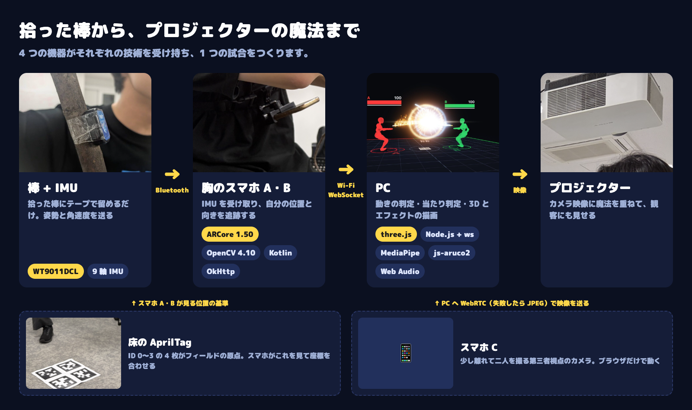

棒の動きは「読む → 見分ける → 置く → 当てて見せる」の 4 段階で魔法になります。

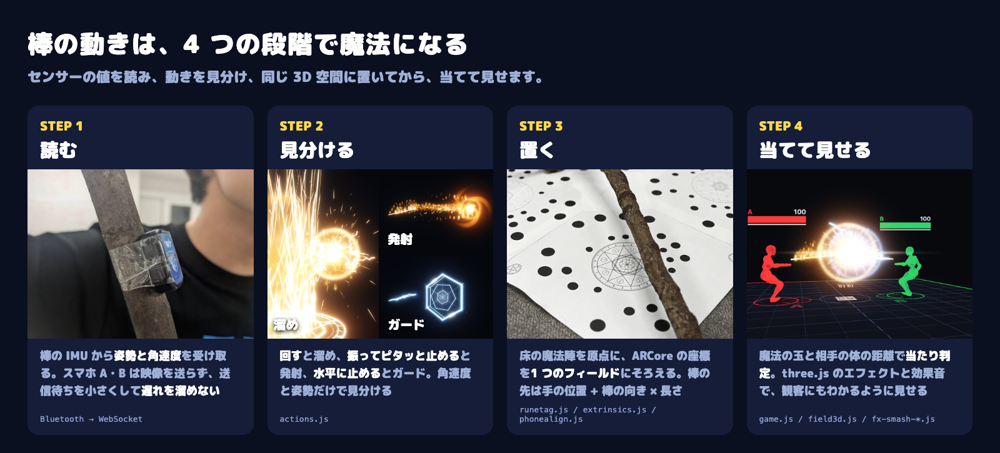

#### API・データ

- Gemini API
  - 炎・雷・溜めのエフェクト用テクスチャの画像生成に使用しました。
- MediaPipe Pose Landmarker のモデルデータ（`pose_landmarker_full.task`）
  - スマホ C の映像から姿勢を検出し、アバターに同じ姿勢をとらせるために使用しました。
- three.js の Xbot モデル（Mixamo 製のリグ付き人体 `Xbot.glb`）
  - アバターの描画に使用しました。
- AprilTag（36h11）の辞書データ
  - 床のタグによる位置合わせに使用しました。魔法陣のマーカーと切り替えられます。
- RUNE-Tag（Bergamasco ほか、2011 年）の考え方
  - 点の並びで ID を表すマーカーの考え方を参考にしました。元のライブラリは使わず、検出器は自作です。
- WebSocket
  - スマホ A・B と PC の間のセンサーデータの中継に使用しました。
- WebRTC
  - スマホ C のカメラ映像を PC へ送信するために使用しました。失敗したときは JPEG に自動で切り替わります。

#### フレームワーク・ライブラリ・モジュール

##### PC（ダッシュボード）

- Node.js + ws 8.18.0
  - ページの配信、WebSocket の中継、https、CDN のキャッシュを行うサーバーです。
- three.js 0.160.0
  - 3D アリーナ、エフェクト、アバターの描画に使用しました。
- MediaPipe Tasks Vision 1.0.1
  - 映像からの姿勢・手の検出に使用しました。Web Worker で動かし、ページが重いときは検出の間隔を自動で延ばします。
- js-aruco2 2.0.0
  - ブラウザでの AprilTag 検出に使用しました。
- qrcode-generator 1.4.4
  - スマホをつなぐための QR コードの表示に使用しました。
- Web Audio API
  - 効果音、BGM、合成音に使用しました。
- バニラ JavaScript（ES Modules）
  - ビルドツールを使わず、そのままブラウザで動きます。

##### スマホアプリ（SensorLink）

- Kotlin / Android SDK（compileSdk 36、minSdk 26）
  - アプリ本体です。
- ARCore 1.50.0
  - スマホの位置・姿勢の追跡に使用しました。
- OpenCV 4.10.0
  - AprilTag の検出に使用しました。
- OkHttp 4.12.0
  - PC への WebSocket 接続に使用しました。

#### その他ツール

| ツール | 用途 | 詳細 |
| :-- | :-- | :-- |
| **Node.js のテストランナー（`node --test`）** | 自動テスト | 位置合わせ、動作判定、ゲームのルールを、実機がなくても確かめられるようにしました。ゲームのルールは 56 本のシナリオで確かめています。 |
| **ダミースマホのシミュレーター（`fake-world.mjs` など）** | ハードなしの動作確認 | 実際のフィールドと矛盾しないように動くダミーのスマホ A・B を作り、センサー班と PC 班が別々に開発を進められるようにしました。 |
| **AprilTag の印刷物（`kawashima/print/`）** | 位置合わせ用のタグ | Python のスクリプトでタグの PDF（A3・A4）を作りました。魔方陣を取り入れる前段階のテストとして使用しました。 |
| **魔法陣のマーカーの印刷物（`product/print/make_runetags.mjs`）** | 位置合わせ用の魔法陣 | A3 に 250 mm 角の魔法陣を 1 枚ずつ、トンボ付きで出力します。ID ごとに中央の魔法陣の絵も変わります。 |

#### デバイス

- WT9011DCL（WitMotion 製 BLE 9軸 IMU センサー）
  - 棒に取り付けて、角速度を取得し、棒の角度を算出します。
- Android スマホ 2 台（スマホ A・B）
  - 胸に装着し、IMU の受信と位置の追跡を行います。
- iPhone 1 台（スマホ C）
  - ブラウザのカメラで第三者視点の映像を撮影します。
- PC
  - サーバーとダッシュボードを動かします。
- プロジェクター
  - 最終映像を投影します。
- 魔法陣のマーカー（A3 に印刷して 250 mm 角に切ったもの 4 枚）
  - 床に敷いて位置合わせに使います。AprilTag の印刷物にも切り替えられます。

### 独自技術

#### ハッカソンで開発した独自機能・技術

- IMU（加速度・角速度センサー）、床の魔法陣のマーカー、ARCore を組み合わせて、対戦相手の絶対座標、棒の位置、角度を算出できるようにしました。
- コードはすべて Hack Day（10/17〜10/18）の期間中に書きました。それより前のコミットは、リポジトリの初期化と README の動作確認だけです。

##### センサー・位置合わせ

- [`16b49c6`](https://github.com/jphacks/os_2619/commit/16b49c6): 魔法陣のマーカー（18 区画 × 3 重の点、中央に魔法陣）の仕様・描画・検出器と、合成画像のテスト
- [`4992742`](https://github.com/jphacks/os_2619/commit/4992742): スマホ A・B のアプリも魔法陣のマーカーを読む（JavaScript の検出器を Kotlin に移植し、同じ画像で結果が一致することを確認）
- 魔法陣のマーカーの描画と検出（点の検出、ID と向きの読み取り、ホモグラフィー）: [`product/dashboard/public/runetag.js`](product/dashboard/public/runetag.js)、アプリへの移植 [`Rune.kt`](product/android/app/src/main/java/jp/jphacks/sensorlink/Rune.kt)
- 床のタグからスマホ C の位置・向き・画角を求める: [`product/dashboard/public/extrinsics.js`](product/dashboard/public/extrinsics.js)
- スマホ A・B を床のタグでフィールドの座標に合わせる: [`product/dashboard/public/phonealign.js`](product/dashboard/public/phonealign.js)
- 棒の動き（溜め・振り・ガード）の判定: [`product/dashboard/public/actions.js`](product/dashboard/public/actions.js)

##### ゲーム・映像

- 試合の進行、当たり判定、弾の挙動、ガード: [`product/dashboard/public/game.js`](product/dashboard/public/game.js)
- 炎・雷・溜めのエフェクト: `product/dashboard/public/fx-smash-*.js`、[`effect-assets/`](effect-assets/)
- 3D アリーナとアバター: [`product/dashboard/public/field3d.js`](product/dashboard/public/field3d.js)

##### 棒の動きの見分け方

棒の IMU からは、姿勢と角速度しかわかりません。その中から、次のように動きを見分けています。

- **溜め**: 棒を回して、回す向きが何度も入れ替わるのを数えます。手の震えでは始まらないよう、始めるときの感知は厳しい条件にしています。棒を斜め上 45° 以上に構えているときのみ認識します。
- **撃つ（振ってピタッと止める）**: 300°/s を超える速さで 60° 以上動き、そのあと 0.12 秒以内に急停止したときだけ発射とします。ゆっくり止めた場合は撃ちません。
- **ガード**: 棒が水平から上下 45° 以内で静止しているときだけ成立します。縦に構えたまま止めても感知しません。
- **技の向き**: 止める直前の棒の先の動きの向きに飛ばします。振った勢いがそのまま向きになるので、体の感覚と合いやすくなります。

##### 位置合わせの考え方

- 床に ID 0〜3 の魔法陣のマーカーを正方形に並べ、それを原点としてフィールドの座標を決めます。
- 魔法陣のマーカーは 1 枚 250 mm 角で、18 区画 × 3 重の黒い点のあり・なしが 54 bit の符号になります。どの 2 つの符号も 20 bit 以上違うので、点がいくつか隠れても読み間違えにくくしています。中央の魔法陣は細い線だけで描いてあり、検出器は塗りつぶした点だけを拾うので、絵が読み取りの邪魔になりません。
- 読めた点すべてからホモグラフィーを求め、紙の中心にある 200 mm の仮想の正方形の 4 隅として返します。そのため、ここから先の計算は AprilTag と同じものを使えます。
- スマホ C の位置は、床の 4 枚のタグの角の位置と画像上の位置から求めます。
- スマホ A・B は、ARCore の姿勢を、見えたタグで向き 1 つと位置だけ合わせてフィールドの座標に置きます。
- 剣の先は、手の位置に、IMU の向きと棒の長さをかけたものを足して求めます。

##### 特に力を入れた部分のコミット

位置合わせ

- [`c6747e5`](https://github.com/jphacks/os_2619/commit/c6747e5): タグの見え方から空間の地図を推定し、合成したシーンで自己チェックする
- [`095a07a`](https://github.com/jphacks/os_2619/commit/095a07a): AprilTag による位置合わせ、偽スマホ、印刷用のタグ
- [`4241898`](https://github.com/jphacks/os_2619/commit/4241898): スマホごとにずれる画面の向き（0/90/180/270°）を床のタグから自動で選ぶ
- [`39e0388`](https://github.com/jphacks/os_2619/commit/39e0388): スマホ C を第三者視点カメラにする（WebRTC と JPEG の自動切り替え）、スマホ A・B の座標合わせ

通信

- [`a2f5626`](https://github.com/jphacks/os_2619/commit/a2f5626): 1 つのポートでページ配信、スマホ A・B の中継、スマホ C の映像をまとめるサーバー
- [`53a0603`](https://github.com/jphacks/os_2619/commit/53a0603): スマホ A・B は映像を送らず、送信待ちを小さくして遅れを抑える

棒の動きの判定とゲーム

- [`ee15ddf`](https://github.com/jphacks/os_2619/commit/ee15ddf): 溜めを、角速度の向きが何度も入れ替わることから見分ける
- [`9831d6c`](https://github.com/jphacks/os_2619/commit/9831d6c): 止めた棒はガード、溜めは揺れでは始まらない
- [`eec25c1`](https://github.com/jphacks/os_2619/commit/eec25c1): 溜め時間で小・中・大が決まるゲームロジックと、シナリオテスト

映像

- [`f356330`](https://github.com/jphacks/os_2619/commit/f356330)、[`6bdfc80`](https://github.com/jphacks/os_2619/commit/6bdfc80): 炎と雷のエフェクト
- [`8461997`](https://github.com/jphacks/os_2619/commit/8461997)、[`d0d3943`](https://github.com/jphacks/os_2619/commit/d0d3943): Xbot の人体モデルのアバターが、スマホ C の映像の姿勢をまねる
